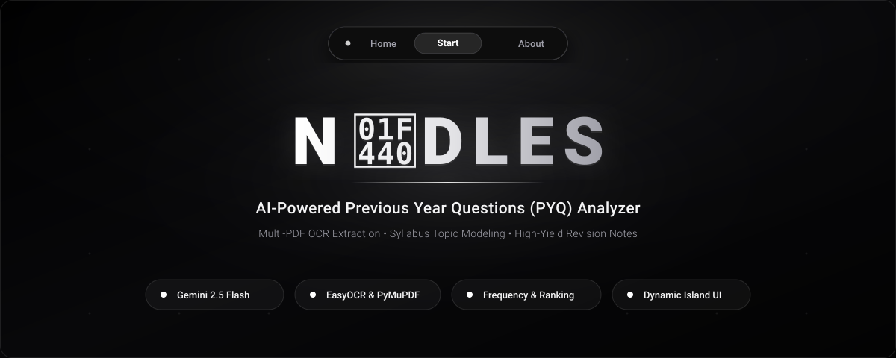
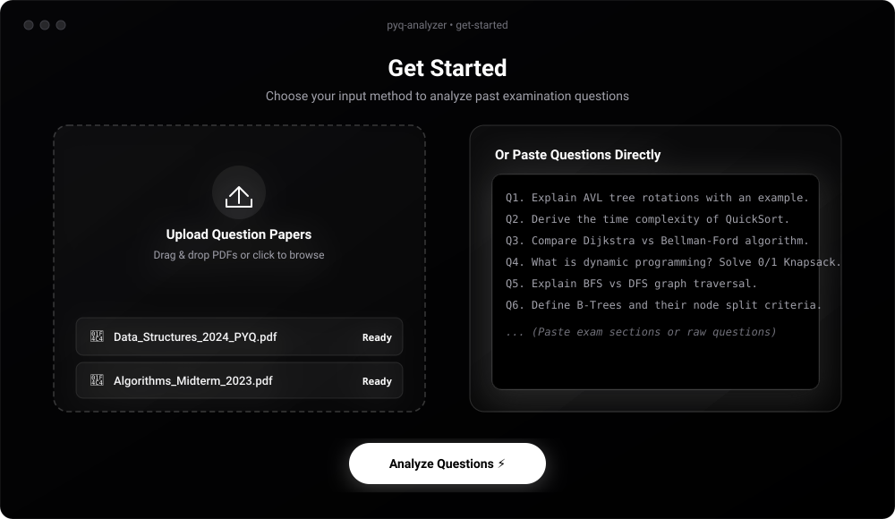
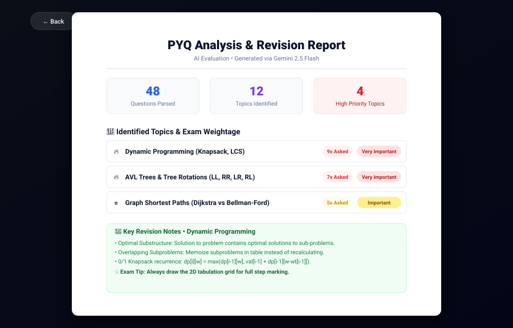
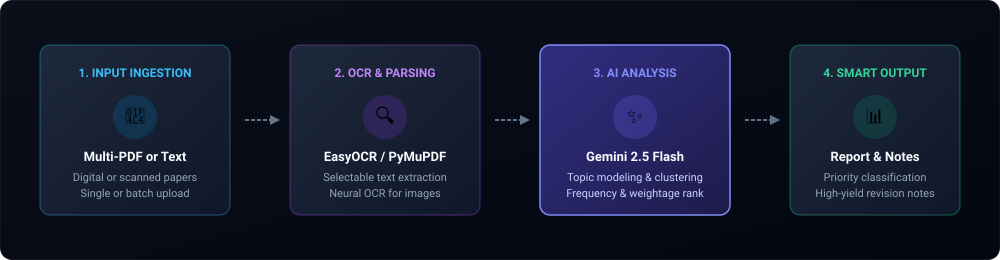
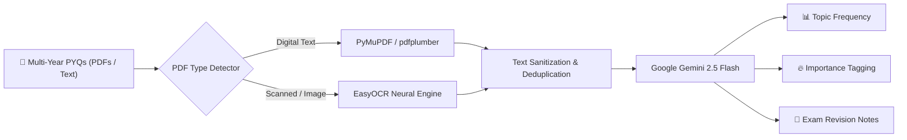

<div align="center">

  

  <br />

  <p align="center">
    <strong>Turn chaotic exam question papers into structured study priorities, topic weightage, and high-yield revision notes using Gemini AI.</strong>
  </p>

  <p align="center">
    <a href="https://github.com/Aditya-602/pyqAnalyzer-noodles/blob/main/LICENSE">
      
    </a>
    <a href="https://react.dev">
      
    </a>
    <a href="https://vite.dev">
      
    </a>
    <a href="https://tailwindcss.com">
      
    </a>
    <a href="https://python.org">
      
    </a>
    <a href="https://flask.palletsprojects.com">
      
    </a>
    <a href="https://ai.google.dev">
      
    </a>
  </p>

  <p align="center">
    <a href="#-overview">Overview</a> •
    <a href="#-screenshots--ui-walkthrough">Screenshots</a> •
    <a href="#-workflow-architecture">Architecture</a> •
    <a href="#-key-features">Key Features</a> •
    <a href="#-quick-start">Quick Start</a> •
    <a href="#-api-reference">API Reference</a> •
    <a href="#-contributing">Contributing</a>
  </p>
</div>

---

## 🌟 Overview

During exam season, students spend countless hours manually cross-referencing past exam papers (PYQs) to predict which topics will appear. **N👀DLES** automates this entire workflow:

1. **Upload your past papers**: Accepts multiple PDF question papers (both text-selectable and scanned images) or raw text.
2. **Extract & Clean**: Combines `pdfplumber`, `PyMuPDF`, and neural OCR via `EasyOCR` to accurately transcribe questions.
3. **Analyze with Gemini 2.5 Flash**: Detects recurring question topics, counts occurrences across years, assigns an exam priority level, and synthesizes concise revision notes.
4. **Interactive Dashboard**: Delivers a clean, print-ready report in an A4 document style, framed within a sleek dark-mode WebGL interface.

---

## 📸 Screenshots & UI Walkthrough

<div align="center">
  <h3>1. Input &amp; Paper Upload</h3>
  <p>Drag and drop multi-year question papers or paste raw questions directly.</p>
  
</div>

<br />

<div align="center">
  <h3>2. AI-Generated Exam Revision Report</h3>
  <p>A4 document layout with topic breakdown, frequency counts, importance tags, and revision points.</p>
  
</div>

---

## 🏗️ Workflow Architecture

The diagram below illustrates how raw exam PDFs flow from ingestion to structured study output:

<div align="center">
  
</div>



---

## ✨ Key Features

- **Dual-Mode Text Extraction**: Automatically detects whether a PDF contains selectable text or requires neural OCR, ensuring 100% extraction accuracy even on scanned question papers.
- **Batch Processing**: Analyze multiple previous year question papers simultaneously to track long-term question trends.
- **Smart Importance Classification**:
  - 🔥 **Very Important**: High-frequency core concepts guaranteed to carry heavy marks.
  - ⭐ **Important**: Frequently recurring sub-topics and conceptual questions.
  - 📌 **Low Frequency**: Fringe questions to review after mastering core topics.
- **Automated Revision Notes**: Provides immediate summary points, formulas, and model answer frameworks for every detected topic.
- **Dynamic Island Menu**: Custom animated floating navigation bar that reacts to user focus and hover interactions.
- **Aurora WebGL Shader**: Fluid, ambient animated background built with [OGL](https://github.com/oframe/ogl).

---

## 🛠️ Tech Stack

| Domain | Technology | Description |
|---|---|---|
| **Frontend Framework** | [React 19](https://react.dev/) + [Vite 7](https://vite.dev/) | High-performance modern SPA with Fast Refresh |
| **Styling** | [Tailwind CSS v4](https://tailwindcss.com/) | Next-generation utility-first styling engine |
| **Icons & Shaders** | [Lucide React](https://lucide.dev/) + [OGL](https://github.com/oframe/ogl) | Sleek icons & WebGL fluid aurora background |
| **Backend API** | [Python 3](https://python.org/) + [Flask](https://flask.palletsprojects.com/) | RESTful API server with CORS enabled |
| **Document Processing** | [PyMuPDF](https://pymupdf.readthedocs.io/) & [pdfplumber](https://github.com/jsvine/pdfplumber) | High-speed text and layout parsing |
| **Computer Vision / OCR** | [EasyOCR](https://github.com/JaidedAI/EasyOCR) | Deep learning OCR fallback for scanned papers |
| **Artificial Intelligence** | [Google Gemini 2.5 Flash](https://ai.google.dev/) | Structured JSON reasoning, topic clustering & notes |

---

## 🚀 Quick Start

### Prerequisites

Ensure you have the following installed on your machine:
- [Node.js](https://nodejs.org/) (v18.0 or higher)
- [Python](https://www.python.org/downloads/) (v3.9 or higher)
- A **Gemini API Key** from [Google AI Studio](https://aistudio.google.com/app/apikey) *(Free tier available)*

---

### 1. Clone the Repository

```bash
git clone https://github.com/Aditya-602/pyqAnalyzer-noodles.git
cd pyqAnalyzer-noodles
```

---

### 2. Configure & Run Backend

Open a terminal and set up the Python environment:

```bash
cd noods/backend

# Create a virtual environment
python3 -m venv venv

# Activate the virtual environment
# On macOS / Linux:
source venv/bin/activate
# On Windows:
# venv\Scripts\activate

# Install backend dependencies
pip install -r requirements.txt

# Create your environment file from template
cp .env.example .env
```

Add your Gemini API key in `noods/backend/.env`:

```env
GEMINI_API_KEY=your_actual_gemini_api_key_here
```

Start the Flask backend:

```bash
python app.py
```

> 🟢 **Backend running at:** `http://127.0.0.1:5001`  
> *Note: EasyOCR will automatically download necessary language models on its initial run.*

---

### 3. Configure & Run Frontend

Open a second terminal window:

```bash
# Option A: Start from repository root
npm run dev

# Option B: Start from noods directory
cd noods
npm install
npm run dev
```

> 🚀 **Application ready at:** `http://localhost:5173`

---

## 🔌 API Reference

### Health Check

```http
GET /api/health
```

**Response:**
```json
{
  "status": "ok",
  "message": "Backend is running"
}
```

---

### Analyze PYQs

```http
POST /api/analyze
Content-Type: multipart/form-data
```

| Parameter | Type | Description |
|---|---|---|
| `pdfs` *(optional)* | `File[]` | One or more PDF question papers |
| `text` *(optional)* | `string` | Raw text of exam questions |

**Response Format:**
```json
{
  "success": true,
  "analysis": {
    "summary": {
      "totalQuestions": 48,
      "totalTopics": 12,
      "highPriorityTopics": 4
    },
    "topics": [
      {
        "name": "Dynamic Programming (Knapsack & LCS)",
        "frequency": 9,
        "importance": "Very Important",
        "commonPatterns": "Tabulation vs memoization, state transition derivations",
        "notes": "Optimal substructure and overlapping subproblems..."
      }
    ]
  }
}
```

---

## 🔒 Security & Best Practices

- **Zero Secret Leakage**: All API keys are loaded via `.env` and strictly excluded in `.gitignore`.
- **Ephemeral Processing**: Uploaded PDF files are processed in isolated temporary directories.
- **Model Storage**: EasyOCR model weights (`.pth`) are cached in a dedicated local model directory and never tracked in git history.

---

## 🗺️ Roadmap

- [ ] **Export to PDF & Markdown**: One-click download of the generated revision sheet.
- [ ] **Flashcard Mode**: Interactive quiz cards based on detected recurring questions.
- [ ] **Subject Preset Prompts**: Optimized analysis prompts for STEM vs. Humanities subjects.
- [ ] **Docker Compose**: Single command containerized deployment (`docker compose up`).

---

## 🤝 Contributing

Contributions are what make the open source community such an amazing place to learn, inspire, and create. Any contributions you make are **greatly appreciated**.

Please review [CONTRIBUTING.md](CONTRIBUTING.md) for full instructions on branching, running tests, and opening Pull Requests.

---

## 📄 License

Distributed under the **MIT License**. See [`LICENSE`](LICENSE) for details.

---

<div align="center">
  <sub>Maintained with ❤️ by <a href="https://github.com/Aditya-602">Aditya Srivastava</a></sub>
</div>
